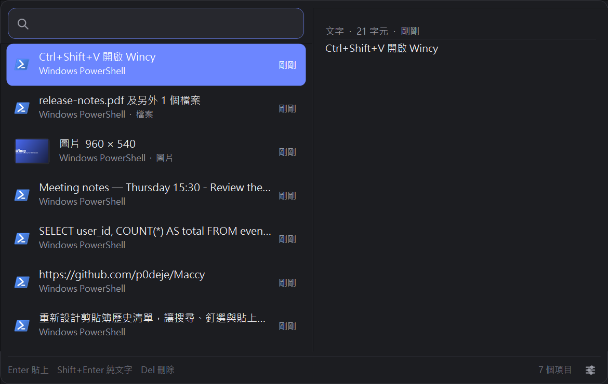
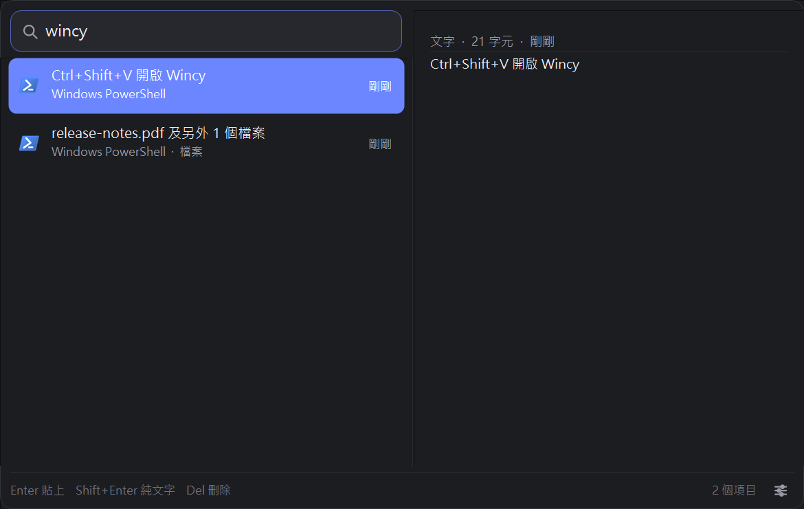
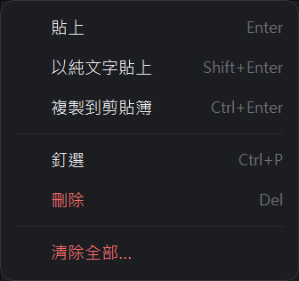
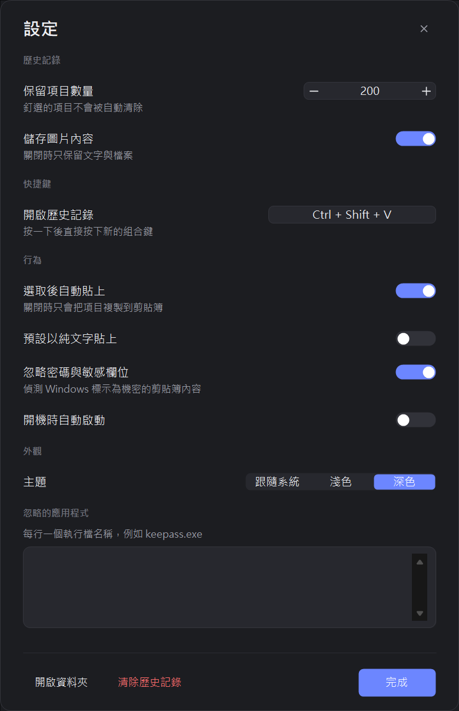
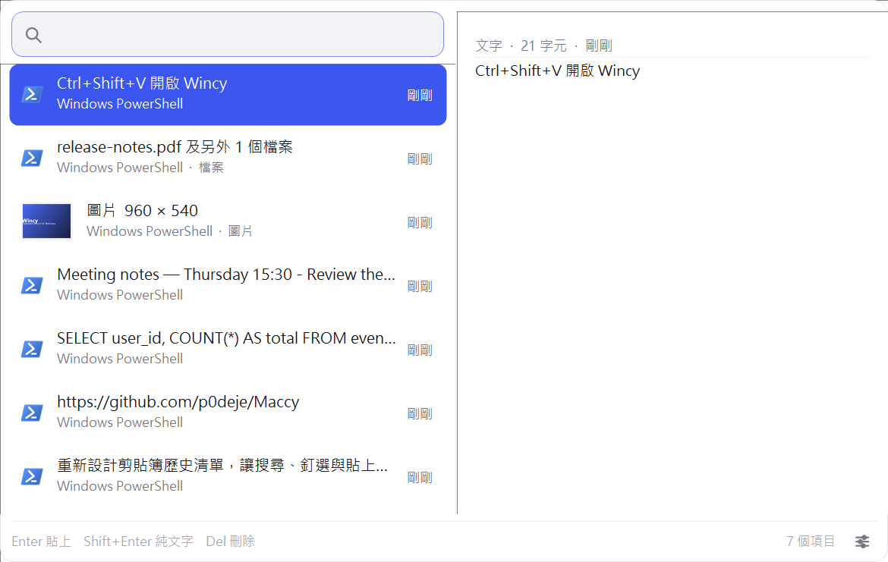
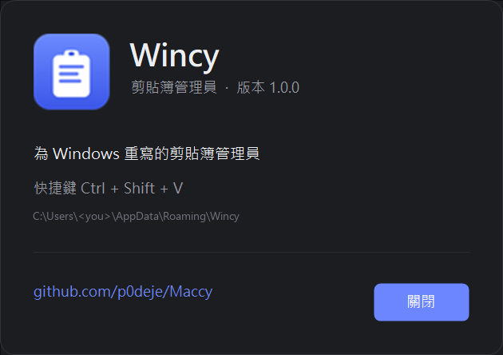
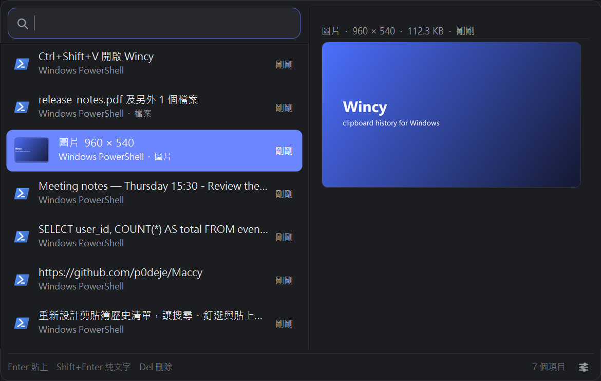

# Wincy for Windows

**繁體中文** | [English](README.en.md)

把 macOS 上的剪貼簿管理員 [Maccy](https://github.com/p0deje/Maccy) 重寫成原生 Windows 版本，取名 **Wincy**（原名 Maccy for Windows，為了不與原專案混淆而更名）：
系統匣圖示、全域快捷鍵、可搜尋與釘選的剪貼簿歷史，貼回原本的視窗。

- **單一 160 KB 執行檔**，不用安裝 .NET SDK、不用 NuGet、不用 Node，也不需要任何執行階段下載
  （直接用 Windows 10/11 內建的 .NET Framework 與 `csc.exe` 編譯）。
- **原生 Win32/WinForms**：冷啟動約 80 ms、常駐記憶體約 32 MB，沒有 Electron 或 WebView。
- **介面跟隨系統語言**（繁體中文 / English）與**系統深淺色主題**。



---

## 目錄

- [功能](#功能)
- [畫面](#畫面)
- [快速開始](#快速開始)
- [鍵盤與滑鼠](#鍵盤與滑鼠)
- [設定](#設定)
- [命令列](#命令列)
- [資料與隱私](#資料與隱私)
- [與原版 Maccy 的對照](#與原版-maccy-的對照)
- [架構](#架構)
- [測試](#測試)
- [開發與發佈](#開發與發佈)
- [已知限制](#已知限制)
- [授權](#授權)

---

## 功能

**擷取**

- 自動記錄剪貼簿的文字、HTML/RTF 富文字、圖片（PNG）與檔案清單。
- 重複內容不會產生重複項目，而是把舊項目移到最上方。
- 尊重 Windows 的機密標記：`CanIncludeInClipboardHistory=0`、
  `CanUploadToCloudClipboard=0`、`ExcludeClipboardContentFromMonitorProcessing`、
  `Clipboard Viewer Ignore` 一律跳過（密碼欄位不會被記錄）。
- 可依執行檔名稱排除特定應用程式（例如 `keepass`、`1password`）。

**使用**

- `Ctrl+Shift+V` 在任何應用程式上方開啟歷史清單（可在設定中改；被佔用時自動退回 `Ctrl+Alt+V`）。
- 打字即搜尋：比對標題、全文、檔名與來源 App，命中字元會高亮。
- 選取項目時右側即時預覽：完整文字（換行、可捲動）、等比縮放的圖片、檔案清單。
- 開啟時不會自動選取項目；把滑鼠移到項目上（或按方向鍵）才會選取，右側預覽同步更新。
- `Enter` 貼上、`Shift+Enter` 以純文字貼上、`Ctrl+Enter` 只複製不貼上、`Ctrl+1`–`Ctrl+9` 直接貼上第 N 項。
- 釘選（`Ctrl+P`）的項目永遠置頂，且不會被歷史數量上限清除。
- 右鍵選單：貼上 / 純文字貼上 / 複製 / 釘選 / 刪除 / 清除全部。
- 貼上流程會先記住原本的前景視窗，關閉浮動視窗後把焦點還給它，再送出 `Ctrl+V`。

**外觀與系統整合**

- 系統匣圖示：左鍵開關歷史、右鍵選單（顯示、開機啟動、設定、清除、關於、結束）。
- 深色 / 淺色 / 跟隨系統；Windows 11 圓角視窗（Windows 10 為直角）。
- 高 DPI（Per-Monitor V2）原生繪製，150%／200% 縮放不模糊。
- 單一實例：重複啟動時會把請求轉給已在執行的副本。
- 開機自動啟動（`HKCU\Software\Microsoft\Windows\CurrentVersion\Run`）。
- 介面文字跟隨系統語言（繁中 / 英文），可在設定中固定。

---

## 畫面

| 搜尋與高亮 | 右鍵選單 |
| --- | --- |
|  |  |

| 設定（深色） | 淺色主題 |
| --- | --- |
|  |  |



右側預覽（圖片）：



---

## 快速開始

### 直接執行

```powershell
dist\Wincy.exe
```

執行後會出現在系統匣。按 `Ctrl+Shift+V`（或 `Ctrl+Alt+V`）開啟歷史清單。

> 需求：Windows 10 1809 以上或 Windows 11。.NET Framework 4.8 是 Windows 內建元件，
> 不需要額外安裝任何東西。

### 從原始碼建置

```powershell
.\build.ps1          # 編譯 dist\Wincy.exe
.\build.ps1 -Test    # 編譯並執行 88 項邏輯自我測試
.\build.ps1 -Run     # 編譯後直接啟動
.\build.ps1 -Clean   # 清除建置產物
```

建置腳本會自動尋找 `%WINDIR%\Microsoft.NET\Framework64\v4.0.30319\csc.exe`
（Windows 內建的 C# 5 編譯器），把 `src\*.cs` 編譯成單一 WinExe，
並嵌入 `src\app.manifest`（DPI 感知、支援的 OS 版本、Common Controls v6）與 `assets\wincy.ico`。

圖示可以用 Pillow 重新產生：

```powershell
python assets\make_icon.py
```

---

## 鍵盤與滑鼠

| 按鍵 | 動作 |
| --- | --- |
| `Ctrl+Shift+V` | 開啟 / 關閉歷史清單（預設；可更換） |
| 直接輸入 | 搜尋目前清單 |
| `↑` `↓` / `PageUp` `PageDown` / `Home` `End` | 移動選取 |
| `Enter` | 貼上（保留原始格式） |
| `Shift+Enter` | 以純文字貼上 |
| `Ctrl+Enter` | 只複製到剪貼簿，不自動貼上 |
| `Ctrl+1` … `Ctrl+9` | 直接貼上第 N 個項目 |
| `Ctrl+P` | 釘選 / 取消釘選 |
| `Delete` | 刪除選取項目（搜尋框為空時） |
| `Ctrl+,` | 開啟設定 |
| `Esc` | 關閉清單 |
| 滑鼠移到項目 | 選取該項目並更新右側預覽 |
| 滑鼠離開項目 | 取消選取（移到右側預覽區則保留，方便閱讀） |
| 滑鼠左鍵 | 貼上該項目 |
| 滑鼠右鍵 | 開啟項目選單 |
| 滾輪 | 捲動清單；在右側預覽上捲動預覽內容 |

系統匣圖示：左鍵開關清單、右鍵開啟選單、雙擊開啟清單。

---

## 設定

| 設定 | 說明 |
| --- | --- |
| 保留項目數量 | 10–5000，預設 200；釘選項目不計入 |
| 儲存圖片內容 | 關閉時只記錄文字與檔案 |
| 開啟歷史記錄 | 全域快捷鍵；點一下再按新組合鍵即可錄製 |
| 選取後自動貼上 | 關閉時只把項目複製到剪貼簿，不送出 `Ctrl+V` |
| 預設以純文字貼上 | 讓 `Enter` 直接以純文字貼上 |
| 忽略密碼與敏感欄位 | 尊重 Windows 的機密剪貼簿標記 |
| 開機時自動啟動 | 寫入目前使用者的 Run 機碼 |
| 主題 | 跟隨系統 / 淺色 / 深色 |
| 忽略的應用程式 | 每行一個執行檔名稱（`.exe` 可省略） |

設定會即時套用並寫回 `settings.json`，不需要按「儲存」。

---

## 命令列

第二次啟動時不會再開一個常駐程式，而是把指令轉發給已在執行的 Wincy
（具名 mutex + 廣播訊息），適合做成捷徑或 AutoHotkey 腳本：

```powershell
Wincy.exe             # 啟動；若已在執行則開啟歷史清單
Wincy.exe --show      # 開啟歷史清單
Wincy.exe --toggle    # 開關歷史清單
Wincy.exe --settings  # 開啟設定
Wincy.exe --about     # 開啟關於
Wincy.exe --clear     # 清除歷史記錄
Wincy.exe --quit      # 結束 Wincy
```

---

## 資料與隱私

資料預設放在 `%APPDATA%\Wincy\`：

```
%APPDATA%\Wincy\
├── settings.json      # 設定（縮排、可手動編輯）
├── history.json       # 歷史記錄（縮排、可讀，直接編輯也有效）
├── images\<id>.png    # 圖片項目的原始 PNG
└── wincy.log          # 診斷記錄，超過 512 KB 會輪替
```

- **可攜模式**：在 `Wincy.exe` 旁邊放一個空的 `portable.txt`，資料就會改存到 `WincyData\`。
- **完全離線**：沒有更新檢查、沒有遙測、不會開啟任何連線。
- **不重複記錄自己**：寫回剪貼簿時會附帶私有格式 `Wincy.SelfWrite`，監聽器據此跳過。
- 歷史檔以原子寫入（暫存檔 + `File.Replace`）儲存，避免當機造成半個檔案。

---

## 與原版 Maccy 的對照

| Maccy（macOS，原專案） | Wincy（本專案） |
| --- | --- |
| 選單列圖示 | 系統匣圖示（左鍵開關、右鍵選單） |
| `⌘⇧C` | `Ctrl+Shift+V`（可更換，衝突時自動退回 `Ctrl+Alt+V`） |
| 歷史清單 + 搜尋 | 相同，子字串比對 + 命中高亮 + 來源 App / 時間 |
| 釘選、刪除、全部清除 | 相同 |
| 純文字貼上（`⌥↵`） | `Shift+Enter`、右鍵選單或設定為預設 |
| 忽略 App | 設定中的「忽略的應用程式」 |
| 忽略機密內容 | 支援 Windows 的機密剪貼簿標記 |
| 歷史數量上限 | 10–5000，預設 200 |
| 開機啟動 | 目前使用者的 Run 機碼 |
| 文字 / 圖片 / 檔案 | 文字、HTML/RTF、圖片（PNG）、檔案清單 |
| Sparkle 自動更新 | 刻意不包含（保持離線、零網路） |
| 多語系 | 繁體中文 / English，跟隨系統 |

---

## 架構

```
src/
├── Program.cs          進入點：DPI 初始化、單一實例、命令列、全域例外處理
├── WincyApp.cs         ApplicationContext：托盤、監聽器、熱鍵、儲存與視窗的整合
├── MainForm.cs         浮動歷史視窗（搜尋框、清單、頁尾、鍵盤操作）
├── HistoryList.cs      自繪清單：圖示/縮圖、高亮、hover、選取、自訂捲軸
├── PreviewPane.cs      右側預覽：自動換行的完整文字、等比縮放的圖片、檔案清單
├── SettingsForm.cs     設定視窗（開關、數量調整器、熱鍵錄製、忽略清單）
├── InfoForm.cs         「關於」視窗
├── MiniMenu.cs         自繪彈出選單（托盤選單、右鍵選單、確認對話框）
├── Controls.cs         SearchBox / ToggleSwitch / Stepper / Segmented / HotkeyBox / IconButton / TextButton
├── Ui.cs               圓角、省略號、分段高亮、App 圖示與縮圖快取
├── Theme.cs            DPI 縮放、深淺色調色盤、字型
├── MessageWindow.cs    隱藏視窗：WM_CLIPBOARDUPDATE、WM_HOTKEY、WM_SETTINGCHANGE、跨實例訊息
├── ClipboardReader.cs  把剪貼簿內容讀成 ClipboardItem（含機密與來源 App 判斷）
├── ClipboardWriter.cs  把項目寫回剪貼簿（文字/RTF/HTML/圖片/檔案）
├── Paster.cs           前景視窗追蹤 + `Ctrl+V` 送出（AttachThreadInput 解前景鎖）
├── HotkeyService.cs     RegisterHotKey 的封裝 + Run 機碼的開機啟動
├── HistoryStore.cs     歷史清單：排序、去重、釘選、上限、原子儲存、孤兒圖片清理
├── ClipboardItem.cs    資料模型 + JSON 序列化 + 單行摘要
├── AppSettings.cs      settings.json 的模型與容錯載入
├── HotkeySpec.cs       快捷鍵的解析、格式化與序列化
├── Search.cs           子字串比對、模糊比對（含評分）與相對時間
├── Json.cs             手寫的最小 JSON 解析/輸出（維持檔案可讀且有序）
├── Paths.cs            資料夾位置、可攜模式、原子寫檔
├── I18n.cs             中英字串表
├── Native.cs           Win32 P/Invoke
└── Log.cs              輪替式記錄檔
```

**一次複製的資料流**

```
使用者複製
   → Windows 送出 WM_CLIPBOARDUPDATE
   → MessageWindow → WincyApp（70 ms 去抖動，避免一次複製收到多個通知）
   → ClipboardReader（檢查機密標記、來源 App、格式）
   → HistoryStore.Add（去重 / 釘選排序 / 上限裁剪）→ history.json + images\*.png
   → 若清單開著就即時更新
```

**一次貼上的資料流**

```
Enter / 左鍵
   → WincyApp.UseItem（記住前景視窗 → 隱藏視窗 → 寫回剪貼簿 → 移到最上方）
   → Paster.SendPaste（還原前景視窗、放開殘留的 Shift/Alt/Win、送出 Ctrl+V）
```

---

## 測試

```powershell
.\build.ps1 -Test              # 88 項邏輯自我測試：JSON、設定、歷史、搜尋、快捷鍵
.\tests\behavior-test.ps1      # 16 項 UI 行為測試：擷取、去重、刪除、釘選、機密內容、點擊外部關閉
.\tests\paste-test.ps1         # 端到端貼上（Enter）
.\tests\paste-test.ps1 -Plain  # 端到端純文字貼上（Shift+Enter）
.\tests\paste-test.ps1 -Rich   # 富文字：保留 HTML 與否
.\tests\make-screenshots.ps1   # 重新產生 docs\ 截圖
```

`behavior-test.ps1` 與 `paste-test.ps1` 會驅動真實的滑鼠鍵盤事件，需要互動式的桌面工作階段
（在遠端或鎖定畫面下無法執行）。`tests\ui.ps1` 提供視窗列舉、截圖、點擊與按鍵等輔助函式。

---

## 開發與發佈

```powershell
git init -b main
git add .
git commit -m "Wincy for Windows 1.0"
git remote add origin https://github.com/<你的帳號>/wincy.git
git push -u origin main
```

- `.github/workflows/build.yml`：push／PR 時在 `windows-latest` 上建置並執行自我測試，
  上傳 `dist\Wincy.exe` 成品；推送 `v*` 標籤時自動把執行檔附到 GitHub Release。
- `.gitignore` 排除 `dist\`、測試產物與 `.pdb`：執行檔以 Release 形式發佈，不進版控。
- `.gitattributes` 統一換行（`*.ps1`、`*.cs` 為 CRLF），圖片與執行檔標為 binary。

發行版本（先修改 `src\AssemblyInfo.cs` 的版本號）：

```powershell
git tag v1.0.1
git push origin v1.0.1
```

## 已知限制

- **權限層級**：Windows 的 UIPI 不允許一般權限程式送按鍵給以管理員身分執行的視窗，
  因此無法自動貼上到提升權限的程式（仍可 `Ctrl+Enter` 複製後手動貼上）。
- **獨佔全螢幕**遊戲或部分 UWP 應用程式可能收不到模擬的 `Ctrl+V`。
- **圖示來源**：從來源執行檔擷取圖示；部分 UWP/Store 應用程式只會顯示通用圖示。
- **沒有雲端同步**（原版 Maccy 也沒有），所有資料都留在本機。
- Windows 10 沒有圓角視窗與部分 Win11 視覺效果（功能相同）。
- 設定視窗需要約 820 dp 的螢幕高度；在 1366×768 這類較矮的螢幕上底部可能超出畫面（可拖曳標題列移動，或改用鍵盤）。
- 沒有自動更新機制：更新就是重新建置，或直接替換 `Wincy.exe`。

---

## 授權

本專案以 MIT 授權釋出。

原始 [Maccy](https://github.com/p0deje/Maccy) 由 [p0deje](https://github.com/p0deje) 以 MIT 授權開發；
這個 Windows 版本是獨立重寫，沿用其產品概念與操作邏輯，程式碼與介面元件皆為全新實作。
